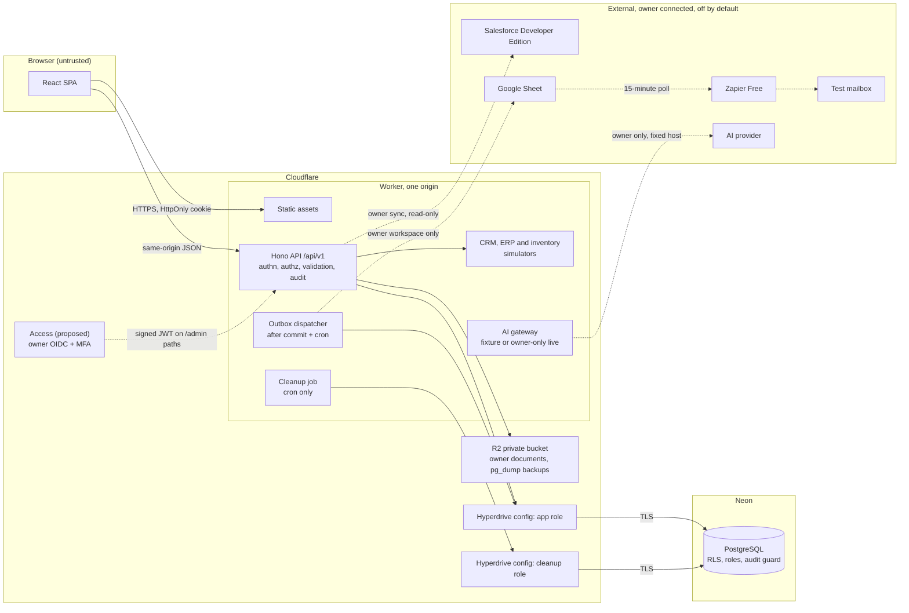

# Architecture

Design at P0. Nothing here is deployed. The scaffold implements only the health route and one domain module, and P1 onward fills in the rest. Stack decision: `ADR/000-stack-and-hosting.md`.

## Runtime

One Cloudflare Worker serves the React assets and `/api` from one HTTPS origin. Everything durable is in PostgreSQL.

Dashed lines stay disabled and show **Not configured** or **Simulated** until Jose authorizes them. The public demo needs none of them.

## Trust boundaries and data flows

| ID | Boundary | What crosses | Control | Failure behavior |
|---|---|---|---|---|
| TB1 | Anonymous browser to API | JSON, demo cookie | Rate limits, strict validation, opaque session, Origin check, deny by default | 401, 403 or 429 with the standard error envelope and a request ID |
| TB2 | Owner to privileged API | Access-signed JWT | Issuer, audience, expiry, signature, subject allowlist | No Access configured means admin paths return 404 |
| TB3 | API to PostgreSQL | Parameterized SQL | Least-privilege role, TLS, `set_config` scope in every transaction, RLS | Transaction rolls back and the caller gets a typed error |
| TB4 | API to R2 | Owner document objects | Private bucket, object key from server state, Worker proxies downloads | 404 for anything outside the workspace |
| TB5 | API to CRM | Read-only records | Owner-only OAuth, server-held token, narrow scopes | Status Degraded; local data stays usable |
| TB6 | API to ERP simulator | Synthetic records | Same adapter contract as a real source; labeled Simulated | Programmed faults exercise retries |
| TB7 | Dispatcher to Sheets, Zapier | Sanitized event | Allowlisted event types, fixed destination, owner workspace only | Retry Scheduled, then Dead Letter; business state unaffected |
| TB8 | AI gateway to LLM | Approved excerpt | Owner only, fixed host, no secrets or tools, strict schema | Fixture fallback, Failed state, safe retry |
| TB9 | CI to infrastructure | Build artifacts, migrations | Pinned actions, narrow permissions, manual release step | Failed check blocks the release |
| TB10 | Cron to PostgreSQL | Purge calls, dispatch | Separate role and config; narrow functions | Next sweep retries; nothing partial, one transaction per workspace |

## Main flows

**Launch demo (TB1, TB3).** `POST /api/v1/demo/sessions`: rate check, then one transaction inserts the workspace and session hash and runs `seed_demo_workspace`. The response sets a `__Host-` cookie. While Neon wakes, the browser shows the waking state from PRD 13.2.

**Scoped read (TB1, TB3).** Middleware resolves the session to a workspace, then `BEGIN`, `set_config('app.workspace_id', $1, true)`, the query with `workspace_id` in its `WHERE`, `COMMIT`. RLS is a second lock, so a missed `WHERE` returns nothing rather than leaking. Reads through Hyperdrive use a new client per request, as Cloudflare recommends.

**Approve (TB1, TB3, TB7).** One transaction: decide the approval if still pending, version-check the case, write the audit row, insert the outbox row. The response returns, then `ctx.waitUntil` dispatches. If the Worker dies at that point, the row is still there and the sweep sends it.

**Dispatch (TB3, TB7).** `claim_due_outbox` leases rows with `FOR UPDATE SKIP LOCKED`. Demo events go to the simulated transport and become Simulated. Owner events go through check-before-append. See `docs/design/INTEGRATION-CONTRACTS.md`.

**Cleanup (TB10).** Every 30 minutes the sweep finds up to 5 expired demo workspaces and calls `purge_demo_workspace` as `opsbridge_cleanup`. Rule in PRD 7.4.

**Document review (TB4, TB8).** Guests pick a fixture whose text shipped with the seed, so public requests never parse a PDF. The result is labeled **Deterministic demonstration fixture**. Owner uploads and live model calls wait for DEC-002 and DEC-003.

## Environments

| Environment | Database | Worker | State |
|---|---|---|---|
| Local | Docker Postgres through `localConnectionString` | `wrangler dev` | Working |
| Staging | Neon branch with its own credentials | Separate Worker | Not created |
| Production | Neon main | Worker | Not created |

Local mode does not run Hyperdrive, so transaction tests must repeat against real Hyperdrive before release.

## Repository layout

| Path | Contents |
|---|---|
| `backend/` | Worker entry, routes, domain modules |
| `frontend/` | React SPA |
| `tests/` | Unit now; integration and E2E later |
| `infra/` | Local Docker, Wrangler templates |
| `sample-data/` | Seed manifest and fixtures |
| `scripts/` | Local CI and helpers |
| `spikes/` | Throwaway P0.2 proofs; not application code |
| `docs/` | Design, briefs, reports, evidence |
