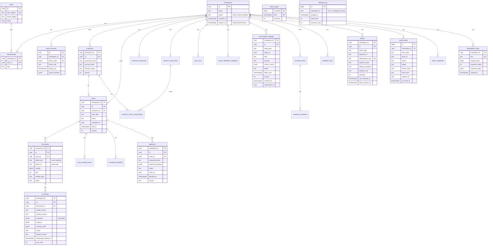

# Entity relationship design

Migrations arrive in P2.1. This is the schema those migrations must implement. `spikes/p0.2/sql/001_schema.sql` proves the role, RLS and audit parts on a subset.

Conventions: UUID keys, UTC `timestamptz`, `workspace_id` on every business table, composite primary keys `(workspace_id, id)` so child foreign keys carry the workspace. Field lists match PRD 7 and 7.3.

Tables without a line in the diagram but with the same conventions: `consultant_handoffs`, `case_checklist_items`, `external_connections`, `external_record_links`, `sync_runs`, `workflow_rules`, `metric_snapshots`, `inventory_items`, `inventory_snapshots`, `source_definition_mappings`, `customer_source_relationships`. Their fields are in PRD 7 and 7.3 and are not repeated here, so the PRD stays the single list.

## Constraints that carry weight

| Constraint | Why |
|---|---|
| `CHECK ((mode = 'demo') = (expires_at IS NOT NULL))` | A demo workspace can't live forever, and an owner workspace can't expire |
| Partial unique index on `workspaces(mode) WHERE mode = 'template'` | Exactly one template |
| `UNIQUE (workspace_id, idempotency_key)` on outbox | One durable event per business intent |
| `UNIQUE (workspace_id, provider, external_type, external_id)` | Repeat sync can't duplicate |
| `CHECK ((object_key IS NULL) <> (fixture_id IS NULL))` on documents | A document is an upload or a fixture |
| `CHECK (status <> 'Deferred' OR defer_until IS NOT NULL)` | A deferral always has a date |
| Status and enum CHECKs | The database rejects vocabulary drift |

## Indexes from day one

`outbox (next_attempt_at) WHERE dispatch_state IN ('pending','retry_scheduled','processing')`, `cases (workspace_id, status, created_at)`, `documents (workspace_id, case_id)`, `workspaces (expires_at) WHERE mode = 'demo'`. Others wait for `EXPLAIN ANALYZE` evidence (PRD 7.1).
